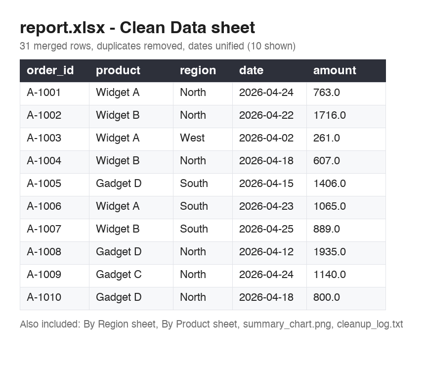
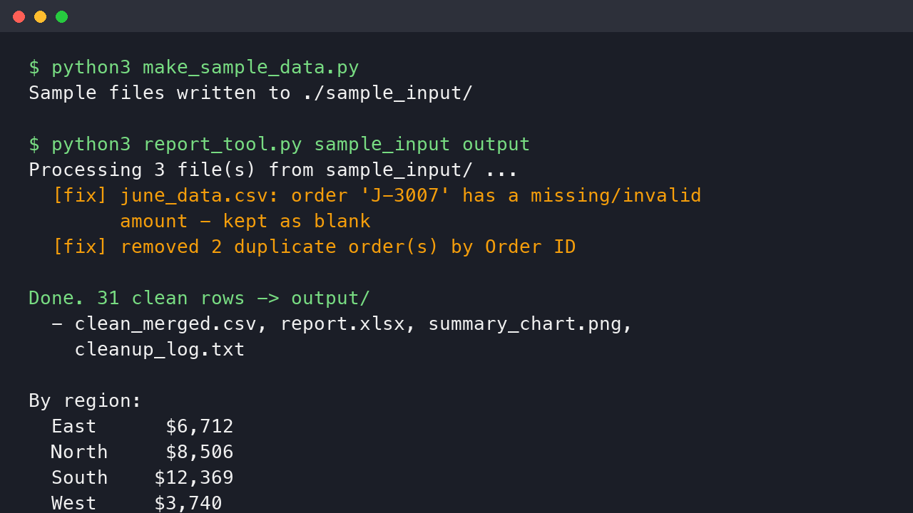
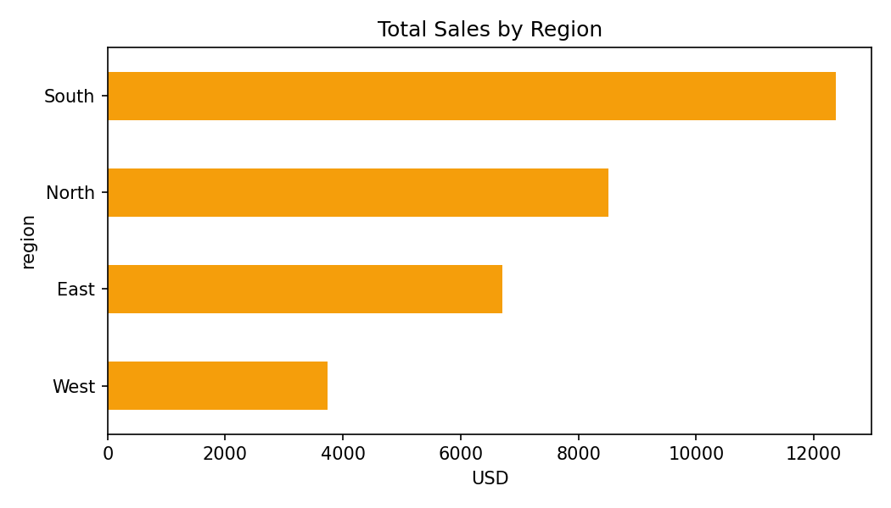

# CSV/Excel Sales Report Tool

Merge multiple messy CSV or Excel files into one clean dataset and get a
summary report — duplicates removed, dates unified, currency strings parsed.

Built by **Zeforge Studio**.

> **Need this done on your own files?** I build custom data-cleaning
> pipelines for businesses — one-off cleanups or reusable scripts.
> **[Hire me on Fiverr →](https://www.fiverr.com/zefworks)**

## What it does

- Accepts any mix of `.csv` / `.xlsx` files in one folder
- Understands inconsistent column names (`Order ID`, `Order #`, `order_id`…)
- Parses mixed date formats (`2026-04-05`, `05/12/2026`)
- Parses dirty currency strings (`" $1,250 "`)
- Deduplicates by order ID, drops empty rows
- Flags rows with missing values instead of silently losing them
- Outputs: clean CSV, Excel report (3 sheets), PNG chart, cleanup log

## Screenshots

| Clean report | Terminal run |
|---|---|
|  |  |



## Quick start

```bash
pip install -r requirements.txt

# 1. generate 3 messy sample files in ./sample_input
python make_sample_data.py

# 2. run the tool
python report_tool.py sample_input output
```

## Output

| File | Content |
|---|---|
| `output/clean_merged.csv` | merged, deduplicated clean data |
| `output/report.xlsx` | Clean Data / By Region / By Product sheets |
| `output/summary_chart.png` | bar chart of sales by region |
| `output/cleanup_log.txt` | every cleanup action that was performed |

## Adapting to your data

If your files use different column names, add aliases to the `COLUMN_MAP`
dictionary at the top of `report_tool.py` — no other code changes needed.

---

Custom version for your data format, extra validation rules, or a scheduled
run? **[Message me on Fiverr](https://www.fiverr.com/zefworks)** — async,
text-only, documented delivery.
